# 찬찬히 버전 3 알고리즘과 판단 흐름

설계 초안 1 · 2026-11-06 · 구현 완료를 뜻하지 않는다.

찬찬히는 사용자의 목표를 유지하면서 현재 화면 전체의 관련 요소를 이해하고, 필요한 작업을 구성한 뒤 사용자가 수행할 행동을 안내한다. 사용자가 조작의 주체다. AI의 제안과 실제 관찰, 사용자 답변과 실제 설정 결과를 구분한다.

이 문서는 특정 앱의 버튼 순서를 미리 정하는 실행 시나리오가 아니다. 그림의 분기는 공통 판단의 종류다. 처음 보는 앱에서 각 항목의 의미와 필요한 작업을 올바르게 생성하는 능력은 실제 모델·앱·사용자 평가로 검증해야 한다.

읽는 순서: D03 전체 판단 → D06 질문 기준 → D05 작업 구성 → D08 안내 유지 → D09 중단 → D12 완료. 호출·입력은 D02, 관찰·탐색은 D07, 늦은 응답은 D10, 복구는 D11에서 확인한다. D13은 원리를 설명하는 예시다.

사각형은 처리, 마름모는 조건 판단, 화살표의 글자는 분기 조건이다. D 번호는 다른 그림의 상세 절차를 가리킨다. 하위 그림의 끝은 전체 앱 종료와 다를 수 있다. D09의 명시 종료·잠금·권한 상실 처리는 모든 그림에 공통 적용한다.

## 1. 합의한 범위와 기본 원칙

| 번호 | 원칙 |
| --- | --- |
| R01 | 일반 앱의 클릭·입력·선택·전송은 사용자가 수행한다. 내부 탐색 스크롤은 별도 제한 기능이다. |
| R02 | 목표의 값, 실제 관찰한 값, 사용자 확인, AI 추정, 확인 불가를 구분한다. |
| R03 | 화면에서 첫 버튼을 찾는 즉시 판단을 끝내지 않는다. 목표에 관련된 항목·묶음·상태·확정 행동을 함께 파악한다. |
| R04 | 모두 필요, 대안 중 하나, 순서, 복수 선택, 조건부, 활동 유지 관계를 표현한다. 발견한 항목 전부를 필수로 만들지 않는다. |
| R05 | 사용자 선택이 있다는 이유만으로 질문하지 않는다. 앱에 바로 입력·선택하도록 안내할 수 있으면 그 방법을 우선한다. |
| R06 | 다음 안내를 구성하는 데 필요한 미지의 사용자 의도만 질문한다. 이미 받은 답을 다시 묻지 않는다. |
| R07 | 질문에 대한 음성·글 답변을 지원한다. 진행 중 사용자의 자유 질의응답 기능은 이번 범위에 포함하지 않는다. 종료·다시 듣기·다음 안내·질문 답변 수정 같은 제어는 유지한다. |
| R08 | 첫 글자, 잠시 멈춤, 키보드 닫힘, 음성 재생 완료를 작업 완료로 보지 않는다. 모든 단계에 확인 버튼을 강제하지 않는다. |
| R09 | 상태 목표가 이미 충족됐으면 불필요한 조작을 생략한다. 새 알람·새 전송 같은 사건 목표는 이번 작업의 새 결과가 필요하다. |
| R10 | 접근성으로 먼저 관찰한다. 필요한 정보가 끝내 부족할 때 허용된 관련 이미지를 한 번의 보완 요청으로 묶을 수 있다. 매 스크롤 이미지를 AI에게 전송하지 않는다. |
| R11 | 숨은 탐색은 안정성·복구 가능성·민감 정보·기기 지원을 확인한 제한 기능이다. 보장되지 않으면 사용자 스크롤 안내로 전환한다. 이미지 좌표를 현재 좌표로 그대로 사용하지 않는다. |
| R12 | 목표 번호·요청 번호·관찰 출처와 수명을 확인한다. 오래된 응답을 새 요청으로 둔갑시켜 적용하지 않는다. |
| R13 | 화면의 의미 판단과 현재 표시 좌표 검증을 구분한다. 가림·키보드·회전·다중 창도 확인한다. |
| R14 | 취소·잠금·서비스 종료 같은 사건은 진행 중 판단보다 우선한다. 종료 후 늦은 응답·음성이 안내를 되살리지 못한다. |
| R15 | 예상과 다른 화면은 재해석한다. 정상 중간 단계와 잘못된 진입을 구분하고, 뒤로가기는 초안 손실 등 영향을 확인한다. |
| R16 | 탐색·연결 재시도 예산과 사용자 안내 단계 수를 구분한다. 8단계 같은 전체 안내 횟수 제한을 두지 않는다. 사용자 입력·활동 대기는 무진행 실패가 아니다. |
| R17 | 전송·결제·삭제 후 결과 불명은 실패 확정이 아니다. 중복 실행을 유발하는 재시도를 안내하지 않는다. |
| R18 | 새 안내는 핵심 행동을 먼저 말하고 보여준다. 다음 안내는 펼치고, 외부 터치·음성 종료만으로 설명을 접지 않는다. 사용자가 명시적으로 접을 수 있다. |
| R19 | 목표 완료를 근거로 확인하면 짧게 종료한다. 기본 흐름에 만족도 질문을 추가하지 않는다. |
| R20 | 지식과 경로는 출처·앱 버전·적용 조건이 있는 참고 자료다. 현재 버튼과 상태를 증명하는 관찰을 대신하지 않는다. |

## 2. D01 역할과 정보의 흐름

사용자 목표와 진행의 소유자는 기기 안의 단일 세션 관리자다. AI는 제안을 반환한다. 그림의 역할 구분은 매번 서로 다른 모델을 여러 번 호출한다는 뜻이 아니다.

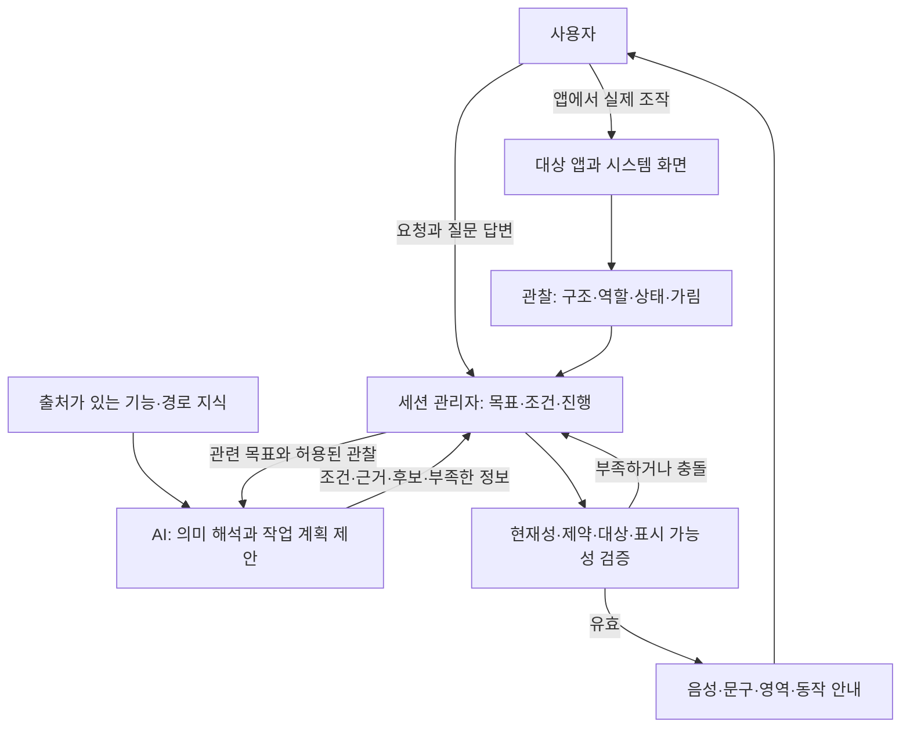

입력 원문·연락처·메시지 등은 필요한 범위와 허용된 경계에서 처리한다. AI 입력에 숨겨진 값이 있다는 사실을 값의 부재로 해석하지 않는다. 필요한 경우 기기 내 비교 결과나 사용자 확인을 사용할 수 있으나 실제 관찰 지원 여부를 별도로 검증한다.

## 3. D02 호출과 요청 입력

권한은 해당 기능에 필요한 시점에 확인한다. 마이크 문제로 글 입력까지 막지 않는다. 인터넷이 연결돼 보인다는 사실만으로 AI 요청 성공을 보장하지 않는다. 음성 인식의 네트워크 의존성도 선택한 인식 서비스에 따라 따로 다룬다.

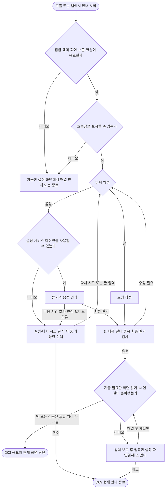

음성 길이·준비 대기·응답 대기 시간은 기능별 자원 정책으로 정하고 실제 기기에서 검증한다. 이 설계에서는 임의의 초 값을 확정하지 않는다. 설정을 거부하거나 해결할 수 없는 경우 종료할 수 있어야 한다.

## 4. D03 전체 판단 반복

화면마다 버튼 하나를 반드시 고르게 하지 않는다. 관찰·질문·안내·대기·복구·완료를 구분한다. 유효하지 않은 자료나 모르는 상황의 기본 경로는 재관찰 또는 제한된 복구다.

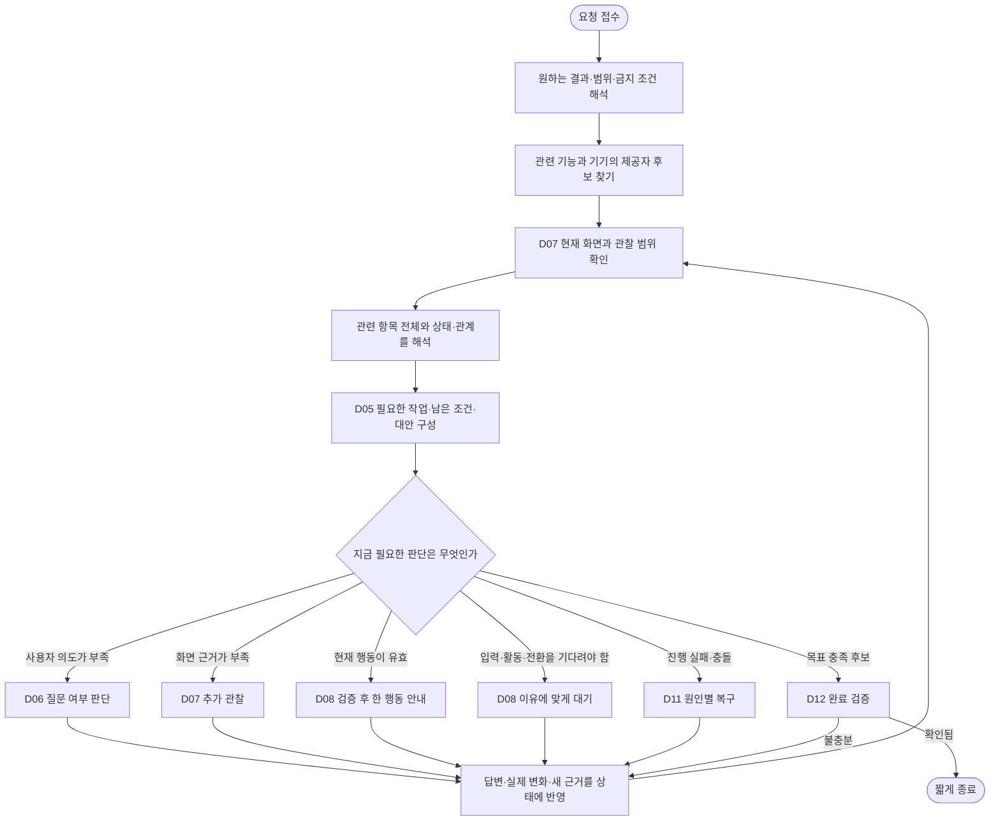

아무 사건도 없는 동안 이 반복을 계속 호출하지 않는다. 사용자 조작, 관련 상태 변화, 답변, 대기 결과, 중단 사건이 판단을 깨운다. 매 단계에 D09 중단 감시와 D10 요청 수명 검사를 적용한다.

## 5. D04 목표 해석과 기능 제공자 선택

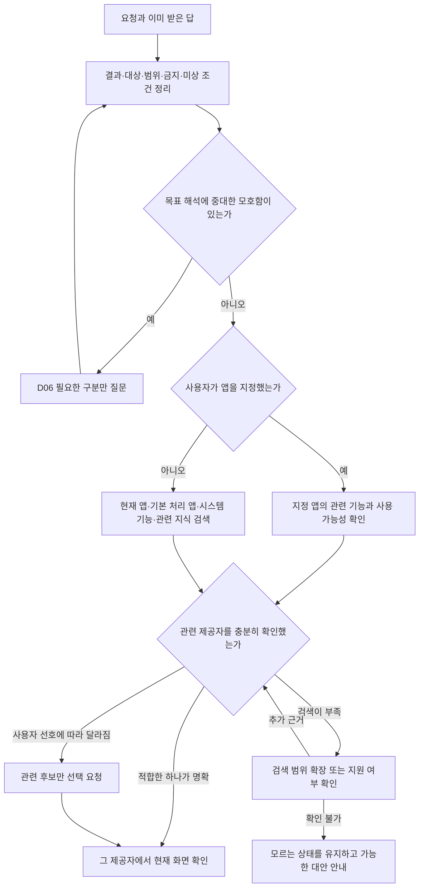

앱 이름을 모르는 사람의 요청을 기본 시험 조건으로 둔다. 공개 기능 처리 앱 조회는 후보를 찾는 근거다. 기능 이름, 현재 앱 안의 실행 가능성, 실제 완료는 서로 별개다. 사용자 답변 수정은 관련 조건과 의존 사실만 갱신한다. 새 목표는 명시적인 새 요청으로 관리하며, 진행 중 자유 질문을 받는 흐름과 구분한다.

## 6. D05 화면 전체에서 작업 계획 구성

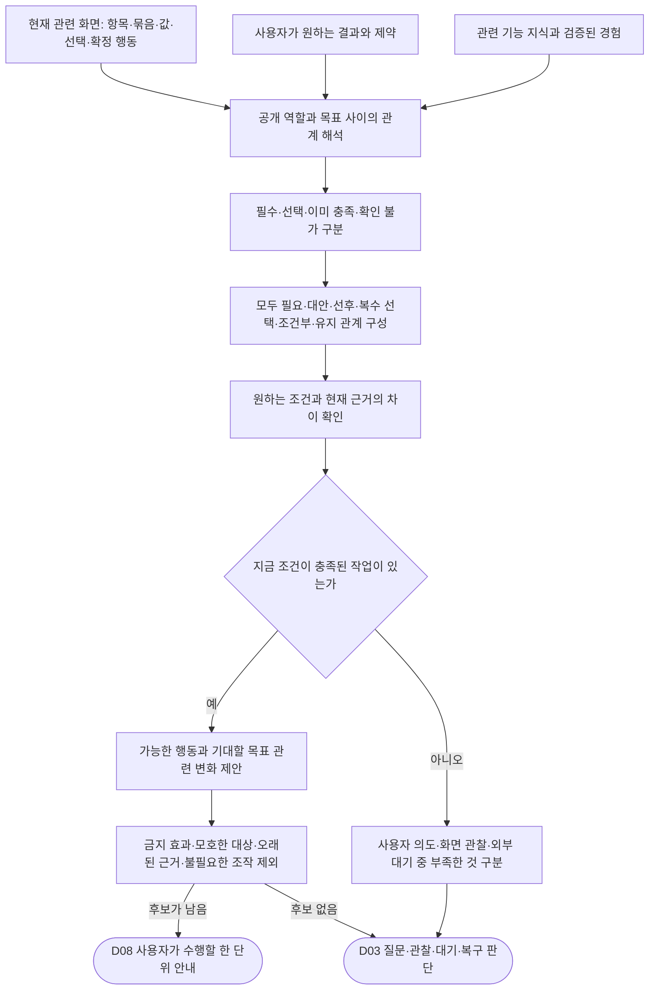

| 관계 | 계획에 담을 의미 | 예 |
| --- | --- | --- |
| 모두 필요 | 필수 조건 전체 충족 | 원하는 시간과 반복 조건, 저장 |
| 대안 중 하나 | 허용된 대안 중 적합한 경로 | 시스템 설정 또는 빠른 설정 |
| 선후 관계 | 선행 상태가 있어야 다음 작업 가능 | 받는 사람 선택 후 작성 화면 |
| 복수 선택 | 한 개가 아니라 원하는 집합을 충족 | 월요일부터 금요일까지 선택 |
| 조건부 | 조건이 실제로 성립할 때만 추가 | 주소가 없을 때 주소 설정 |
| 활동 유지 | 진행 중 상태를 유지하고 종료 조건 대기 | 측정 시작 후 사용자가 끝낼 때까지 유지 |

복수 선택은 선택 횟수가 아니라 원하는 집합과 현재 집합의 차이로 본다. 시간 조절은 반드시 오전·오후부터 시작하는 고정 순서가 아니다. 24시간제, 이미 맞는 값, 숫자 직접 입력 등 실제 구조에 맞춰 구성한다. AI의 계획과 관계도 근거에 연결된 가설이며 의미 정확성은 검증 대상이다.

2026-11-07 구현에서 D05·D08·D12의 검사 시점을 구체화했다. 확정 전 준비(`PREPARATION`)와 확정 후 목표 결과(`OUTCOME`)를 구분하고, 각 확정 대상에 필요한 준비 조건을 결합한다. 현재 대상의 필수 준비가 모두 현재 근거로 충족돼야 확정 안내를 표시한다. 이전에 결합한 준비는 다음 계획의 생략이나 행동 효과 이름 변경으로 지워지지 않는다. 확정 후 완료 검사에는 최종 결과 조건을 사용하며 이전 편집 화면을 다시 요구하지 않는다. 표시 뒤 준비 근거가 바뀌면 읽기 전용 항목이어도 기존 안내를 무효화한다. 이 검사는 AI가 최초에 빠뜨린 조건이나 잘못 해석한 값 자체를 증명하는 기능과 다르다. 구현·반례·검증의 최신 범위는 `android/app3/IMPLEMENTATION.md` 7회차와 `PROGRESS.json`에 기록한다.

9회차에는 조건 정의에 공개 값 비교 `expectations`를 연결했다. 숫자 범위의 현재 값, 체크 상태, 선택 상태를 단말이 기대 값과 비교하며 여러 비교는 모두 충족해야 한다. 기대 값·대상·비교 종류는 조건의 버전·출처 권한에 따라 유지한다. 새 화면에서 처음 비교할 수 있게 되면 기존 문구·필수 여부·phase·비교를 유지하고 검사만 추가하는 명시적 강화가 가능하다. 원래 사용자 조건의 출처를 추론으로 낮추지는 않는다. 비교 대상이 모호하거나 메타데이터가 없으면 확인 불가다. 희망 값이 미상인 UNKNOWN 질문에는 기대 숫자를 강제하지 않는다. 답을 받으면 해당 조건 범위에서 명시적으로 정의를 갱신하고 현재 관찰과 비교한다. UNKNOWN은 확정 준비를 충족시키지 않는다. 최초 숫자·단위·대상의 의미 해석, 비공개 입력의 작성 완료, 실제 저장 결과의 의미를 이 비교 하나로 증명했다고 보지 않는다.

13회차에는 `INPUT_PRESENT`를 추가했다. 사용자가 비공백 입력을 요구하면 true, 비공백 입력이 없어야 하면 false를 해당 조건의 기대 값으로 유지하고 현재 편집 노드의 공개 메타데이터와 대조한다. 빈 값의 작성 종료를 선언해도 true 조건이 충족되지는 않는다. 반대로 입력이 존재해도 작성 종료를 대신하지 않는다. 비교 대상은 현재의 유일한 공개 입력이어야 하며 비밀번호·민감·가림·읽기 실패·모호한 대상은 근거로 사용하지 않는다. 편집 내용의 숫자·선택 같은 다른 비교를 새로 허용한 것은 아니다. 모든 편집 노드의 존재를 필수 조건으로 승격하지 않으며, 최초 조건과 비교 대상의 누락·의미 오류는 별도 검증 대상이다.

34회차에는 비활성 이동 버튼의 공개 설명이 여러 입력 이름을 열거하고 모두 요구하는 경우를 연결했다. 같은 카드에서 해당 입력란 각각을 찾고 현재 입력 존재를 대조한다. 계획은 각 입력의 필수 준비 조건과 이동 전 관계를 담는다. 값이 있는 입력은 충족된 준비로 보고하고 남은 입력을 안내한다. 입력란 하나를 찾지 못하거나 입력 존재를 읽을 수 없으면 앱의 공개 설명을 표시하고 대기한다. 필수 입력의 누락은 같은 관찰에서 기존 보정 예산으로 한 번 수정한다. 입력 사이 순서는 앱의 근거와 계획에 맡긴다. 현재 범위는 지원하는 한국어 문장 형태와 이 입력 준비 경로에 한정된다.

## 7. D06 질문할지 앱에서 조작하게 할지 결정

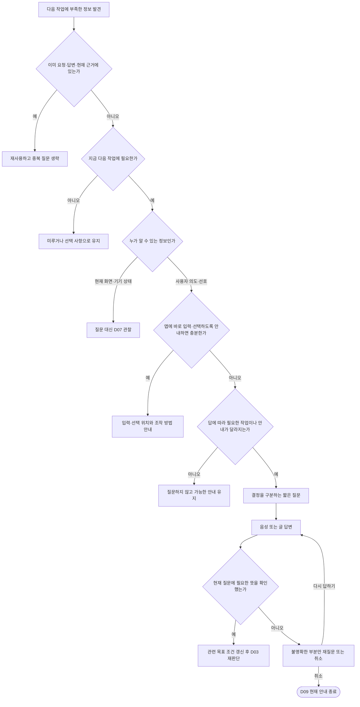

반복 오인식·무응답을 무한 재질문으로 처리하지 않는다. 글 입력·가능한 선택·취소를 제공하고, 답변 대기는 사용자 실패로 세지 않는다. 답변에서 필요한 범위를 넘는 개인정보를 수집하지 않는다.

질문 내용을 보존하는 것과 지금 답변을 받을 수 있는 것은 구분한다. 중단·다른 앱 진입·화면 확인 불가 때에는 질문 창을 정리하고 답변을 받지 않는다. 재개할 때 현재 화면으로 질문을 다시 검증한다. 같은 문구와 key의 질문이 다시 열려도 이전 창의 클릭·음성 결과를 새 질문에 적용하지 않는다. 유효한 답변으로 목표 조건을 갱신했다면 이전 작성 종료 선언을 만료시키고 새 계획을 만든다. 11회차에는 실제 질문 창의 교체와 오래된 글 답변 거부를 검증했다. 실제 마이크와 모든 기기의 중단 동작을 검증했다는 뜻은 아니다.

| 상황 | 질문 판단 | 안내 예 |
| --- | --- | --- |
| 받는 사람 검색칸이 열림 | 앱에 바로 입력하면 충분 | 이름이나 전화번호를 검색해주세요. |
| 동명이인 결과 | 앱에서 구분해 고를 수 있으면 선택 안내 | 받는 사람을 확인하고 선택해주세요. |
| 알람 설정 화면에서 목표 시각이 미상 | 목표 시각에 맞춘 조절 안내가 필요하면 질문 | 언제 울리게 할까요? |
| 사용자가 시간 조절 방법만 요청 | 구체적 시각을 몰라도 안내 가능 | 시 영역을 위아래로 움직여주세요. |
| 평일 오전 7시 반을 이미 답함 | 시각·요일 재질문 생략 | 현재 값과 비교해 필요한 항목부터 안내 |
| 소리·진동 등 요청과 무관한 옵션 | 필수로 만들지 않음 | 현재 설정 유지 |

## 8. D07 관찰과 제한 탐색 및 이미지 보완

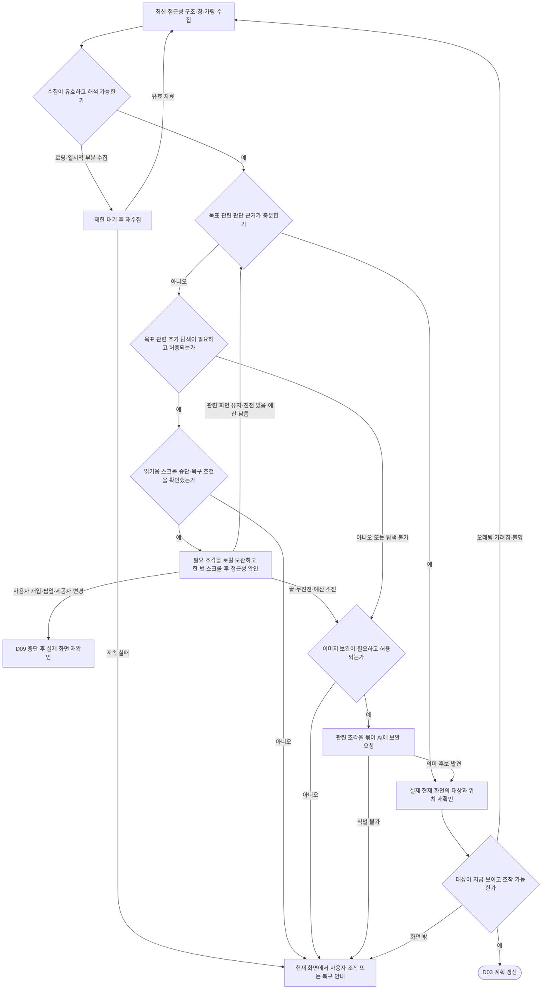

탐색 중 대상이 발견되면 탐색을 끝내고 실제 위치를 재확인한다. 로컬 탐색 결과를 현재 화면의 사실과 혼합하지 않는다. 화면 밖에서 찾은 항목은 사용자 스크롤 후 새로 표시한다. 합친 이미지에는 원본 조각·화면 세대·오프셋을 보관한다. 원래 위치를 복구하지 못하면 복구했다고 말하지 않는다. 첫 사용자 터치를 뒤에서 이동한 다른 항목에 재생하는 방식은 쓰지 않는다.

숨은 탐색은 기기 지원과 안전성 검증 전에는 기본 기능으로 확정하지 않는다. 로딩·무한 목록·가상화·중복 항목은 끝과 무진전 및 미관찰 영역을 구분한다. 전체 앱에 기능이 없다는 결론으로 바꾸지 않는다.

25회차에서는 같은 이름의 이동 버튼이 여러 개일 때, 사용자가 요청에서 명시한 공개 제목과 버튼이 현재 트리의 같은 묶음에 있을 때만 범위를 좁힌다. AI가 해당 제목을 범위 근거로 제시하고, 기기가 다른 후보와 구분되는지 확인한다. 강조 중에도 제목과 버튼의 관계를 다시 확인한다. 같은 이름의 제목이 여러 개이거나 범위가 달라지면 안내를 멈추고 현재 화면을 다시 확인한다. 이번 연결은 일반 이동과 조회를 다룬다.

26회차에서는 제목과 버튼이 다른 하위 묶음에 있어도 가장 가까운 공통 묶음과 그 안의 유일한 같은 이름 버튼을 확인할 수 있으면 범위를 인정한다. 중간에 스크롤·클릭 영역이 있거나 화면 전체 또는 여러 버튼의 공통 목록에서만 제목이 연결되면 보류한다. 제목과 버튼이 같아도 둘을 묶는 근거가 바뀌면 강조를 갱신하기 전에 다시 관찰한다.

18회차 개발 빌드는 대상 앱의 접근성 관찰이 일부만 들어오면 기존 강조와 안내 조작을 해제한다. 400ms 뒤 한 번 다시 읽고, 2초 안에 유효한 자료가 없으면 같은 앱 위에서 ‘다시 시도’를 제공한다. 그 전에 유효한 자료가 오면 해당 화면을 다시 검증한다. 부분 관찰이 반복되어도 대기 시간은 다시 시작하지 않는다. 이 시간은 공개 시험 화면에 적용한 개발 값이며 제조사별 최적값은 실기기 검증이 필요하다. 부분 관찰 전에 강조한 확정 대상의 뒤늦은 클릭이 같은 관찰 문맥에서 감지되면 결과 불명으로 보관해 중복 안내를 막는다.

## 9. D08 안내와 사용자 대기 상태

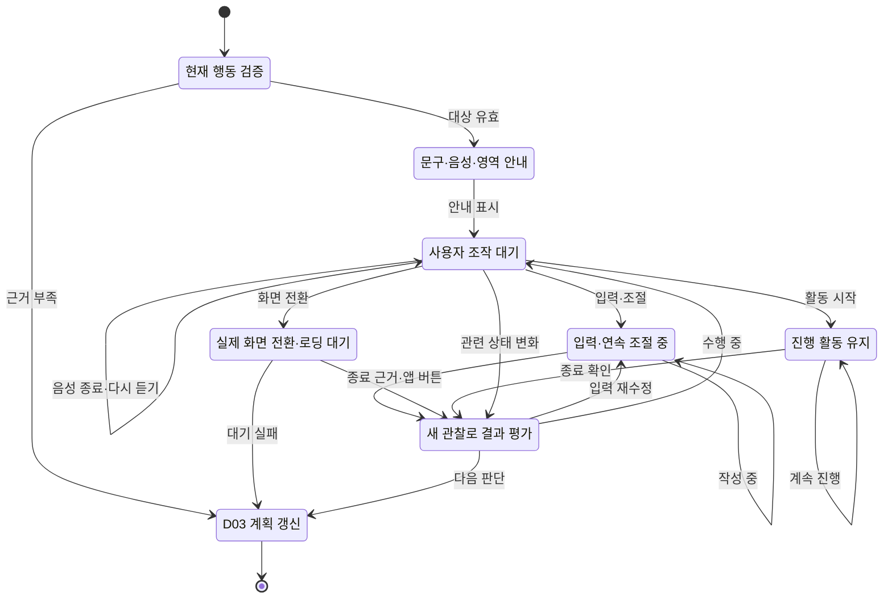

입력 중 첫 글자와 잠깐 멈춤은 완료가 아니다. 사용자 다음 안내 요청도 실제 값의 정확성을 증명하지 않는다. 값 조건을 관찰로 확인할 수 있으면 필요한 범위에서 진행하고, 확인이 어려우면 앱 내 확인이나 선택적인 다음 안내 요청을 사용한다. 활동 유지 중 다음 버튼을 억지로 고르지 않는다.

10회차에서는 D08의 작성 종료 근거를 단말에서 구체화했다. 명시적 ‘입력했어요’는 현재 입력·범위·수정 세대의 사용자 선언이며 비공개 내용의 정확성이나 저장 성공이 아니다. 실제 수정과 관련 대상 변경은 선언·강조·늦은 응답의 수명을 무효화한다. 포커스·잠시 멈춤·입력 존재·다른 버튼 클릭은 이 근거를 만들지 않는다. 현재 보이는 입력과 이번 확정의 소유 준비에 묶인 입력을 검사하고, 사라진 관련 없는 보조 입력을 완료로 꾸미거나 새 작업의 전역 차단으로 삼지 않는다. 원문·키가 있는 비교 결과는 외부 요청에 추가하지 않는다. 11회차 공개 합성 장면에서는 기존 Terra low가 작성 중·명시 종료·수정 후 만료를 구분했다. 안내는 실제 오버레이 버튼을 가리키며 지원하지 않는 자유 대화를 요구하지 않는다. 구현·반례·시험 범위는 `android/app3/IMPLEMENTATION.md` 10–14회차에서 구분한다.

12회차에는 읽을 수 있는 빈 입력도 ‘비워두었어요’로 명시 종료할 수 있게 했다. 값이 있으면 ‘입력했어요’를 사용한다. 읽기 실패인 null과 빈 값인 false를 구분하고, 빈 화면을 관찰하거나 IME 동작을 지원한다는 사실만으로 선언을 발급하지 않는다. 지우기·다시 입력하기는 이전 선언을 취소한다. 선언은 필수 값을 생략해도 된다는 허가나 원래 목표 변경이 아니며, 준비 조건과 최종 결과는 별도로 확인한다. 13회차에는 이 선언과 별도로 `INPUT_PRESENT` 조건을 단말과 서버에서 대조했다. 같은 빈 입력의 종료 선언에서도 실제 Terra는 필수 설명이면 입력 안내, 비워두기 목표이면 저장 안내를 반환했고 저장 결과는 UNKNOWN으로 유지했다. 앱 자체 검색·다음·완료의 일반 어댑터, 새 초안·전체 앱 평가는 남아 있다.

현재 수집기의 입력 유무는 비공백 문자가 있는지에 대한 메타데이터다. false에는 힌트 표시와 공백만 있는 입력도 포함되며 원문 길이 0을 보장하지 않는다. 글자 수 0이나 특정 문장과의 일치가 필요한 목표는 이 불리언 하나로 검증하지 않는다.

14회차에는 입력 수정으로 이전 표시가 없어져도 앱의 공개 버튼 클릭으로 재관찰을 요청할 수 있게 했다. 현재 세션·목표 버전·전경·창·출처·공개 대상·사건 시각을 확인하며, 클릭은 작성 종료나 제출 성공으로 기록하지 않는다. 클릭 수신 뒤에 읽기 시작한 완전한 현재 화면에서 다음 계획을 만들고, 재관찰 뒤에도 미완료 입력과 소유 조건은 유지한다. 최근 수락한 입력 재관찰 클릭의 중복 전달은 다시 적용하지 않는다. 현재 원형은 400ms 뒤 한 번 더 읽고 총 2초 안에 사용할 수 있는 관찰을 얻지 못하면 명시 재확인을 기다리는 일시 중단으로 전환한다. 이 예산은 화면 읽기에 대한 것이며 사용자 입력·전체 안내 단계·AI 추론의 시간 제한이 아니다. IME 동작을 보편적으로 관찰하는 기능은 아직 별도 과제다.

15회차에는 화면 전환 대기(`SCREEN_TRANSITION`)에서 계획이 관련 있다고 지정한 공개 읽기 전용 항목도 관찰한다. 버튼과 창이 그대로여도 ‘검색 중’이 ‘검색 결과 없음’으로 바뀌면 기존 안내와 요청을 무효화하고 현재 화면을 다시 해석한다. 재분석 중 다시 바뀌면 새 상태를 기준으로 요청 수명을 갱신해 이전 상태의 늦은 응답을 거부한다. 같은 내용의 반복 캡처·좌표·포커스 변화만으로 요청하지 않으며, 관련 없는 글·비공개 입력·사용자 활동 대기의 시계 변화를 전부 추적하지 않는다. 기존에 관찰하던 항목이 사라지거나 읽을 수 없게 된 경우도 재확인 대상이다. 선택 범위가 올바른지와 실제 결과가 목표를 충족하는지는 별도 의미 판단이다. 이 사건 자체는 작성 종료·확정 실행·목표 완료의 근거가 아니다. 모델이 지정한 공개 항목 최대 180개는 요청 관찰의 자원 한도이며 안내 단계 수 제한이 아니다. 실제 기기 관찰 주기와 무진행 복구 예산의 일반화는 후속 검증으로 남긴다.

새 행동 문구는 펼친 상태로 표시하고 설정이 허용하면 한 번 읽는다. 다시 듣기와 종료는 아이콘·텍스트를 함께 둔다. 헤더의 명시적 접기·이동은 표현 상태이며 과업 진전이 아니다. 강조와 동작 시연은 실제 조작을 가리지 않아야 하고, 시스템의 동작 줄이기·음성 끄기를 따른다. 터치로 화면 고정을 해제해도 안내 문구까지 자동으로 접지 않는다.

16회차에는 패널 배치에 현재 계획의 관련 공개 근거도 전달했다. 클릭할 수 없는 결과·상태 문구도 가림을 줄일 대상이다. 수락 당시의 좌표를 고정하지 않고 같은 패키지·창·출처에서 의미가 유지된 유일한 항목의 현재 좌표로 배치한다. 넓은 문맥 컨테이너와 그 안의 구체적인 항목이 함께 지정되면 구체적인 항목을 우선하며, 비공개 입력·민감 미리보기는 이 표현 근거에 넣지 않는다. 재분석·일시 중단·종료 시 표현 근거를 지우고, 의미가 달라졌거나 부분 화면·이전 관찰이면 예전 사각형을 쓰지 않는다. 위치만 바뀐 경우에는 AI 호출이나 작성·완료 선언을 추가하지 않는다. 강조 대상의 기존 우선순위와 사용자의 접기·드래그는 유지한다. 위아래 두 배치가 모두 겹치는 좁은 화면·큰 글자·키보드 상황을 모두 해결한 배치는 아니며, 정보가 덜 가려진다는 사실도 목표 달성의 증거는 아니다.

30회차에는 29회차에 확인한 필수 입력과 이름이 같은 이동 버튼의 관계를 작성 대기와 종료 선언에서도 확인한다. 사용자가 같은 입력란에 글을 넣는 동안에는 다음 계획을 요청하지 않는다. 버튼이 활성화돼도 작성 종료를 추정하지 않는다. 버튼이 계속 비활성인 채 앱의 공개 설명이 다른 요구로 바뀌거나 같은 카드임을 확인할 수 없으면 이전 입력 안내를 거두고 현재 화면을 평가한다. 이 경로에서 필수 입력란이 비어 있으면 종료 버튼을 비활성화한다. 일반 입력 흐름에서는 기존의 ‘비워두었어요’ 선언과 필수 조건 확인을 각각 적용한다.

35회차에는 같은 카드의 여러 필수 입력에서 이전 작성 종료가 편집으로 취소되는 경로를 검증했다. 첫 입력을 다시 작성해 종료해도 둘째 입력의 종료를 대신하지 않는다. 다음 계획이 현재 활성화된 같은 카드의 이동 버튼을 제안하면, 이미 안내했고 아직 종료 선언이 없는 현재 입력란을 먼저 다시 표시한다. 값이 남아 있으면 입력을 마쳤는지 확인하도록 안내한다. 이미 값이 채워진 상태로 처음 관찰했고 안내한 적 없는 입력에는 이 추가 선언을 요구하지 않는다.

## 10. D09 중단과 수명 관리

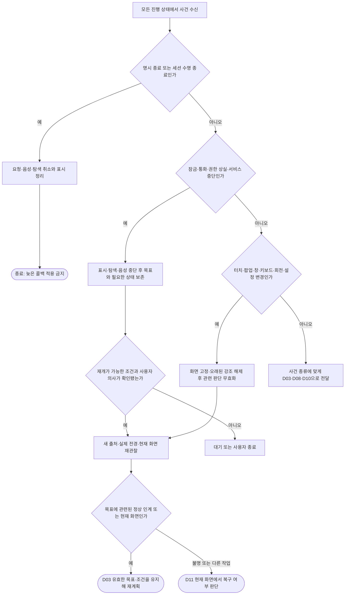

잠금 해제를 자동 실행하지 않는다. 앱 재시작·프로세스 종료 후 실행 중이던 조작을 자동 재생하지 않는다. 목표·선호 같은 지속 상태와 노드·좌표·음성·진행 중 요청 같은 일시 상태의 복구 범위를 나눈다. 시스템 사진 선택기 등 정상 인계는 원래 목표 앱을 덮어쓰지 않고 현재 제공자와 연결한다.

자체 질문 오버레이가 입력 포커스를 가져가는 상황을 다른 앱 진입으로 혼동하지 않는다. 11회차 구현은 같은 접근성 연결에서 직전에 확인한 대상 앱의 최상위 창이 실제로 유지되는지 창 번호·패키지·새 루트로 대조한 뒤 그 아래 트리를 새로 읽는다. 예전 좌표를 재사용하는 처리가 아니다. 자체 질문 창이 열린 동안 출처가 잠시 불명확하면 제출·녹음을 막고 제한된 재관찰을 수행한다. 현재 원형의 750ms 예산 안에 복구되지 않으면 명시 재확인을 기다리는 일시 중단으로 전환한다. 반복 사건으로 이 예산을 계속 늘리거나 질문을 자동 재생성하지 않는다. 다른 앱·서비스 변경·잠금은 기존 중단 경계대로 처리한다. 다중 창·기기별 창 계층·실제 음성에 대한 검증은 별도다.

17회차에는 일시 중단 중의 앱 클릭을 진행 중인 과업의 실행 기록으로 발급하지 않도록 했다. 현재 연결과 전경이 확인되지 않는 경우도 마찬가지다. 중단 중 사용자가 독립적으로 한 작업을 원래 목표에 몰래 귀속시키지 않는다. 반대로 기록이 없다는 사실은 아무 일도 실행되지 않았다는 증거가 아니다. 중단 중의 효과나 처음 보는 확정 행동의 불확실성을 재개 시 대조하는 일반 원장은 아직 별도 과제다.

## 11. D10 AI 요청과 늦은 응답의 시간 순서

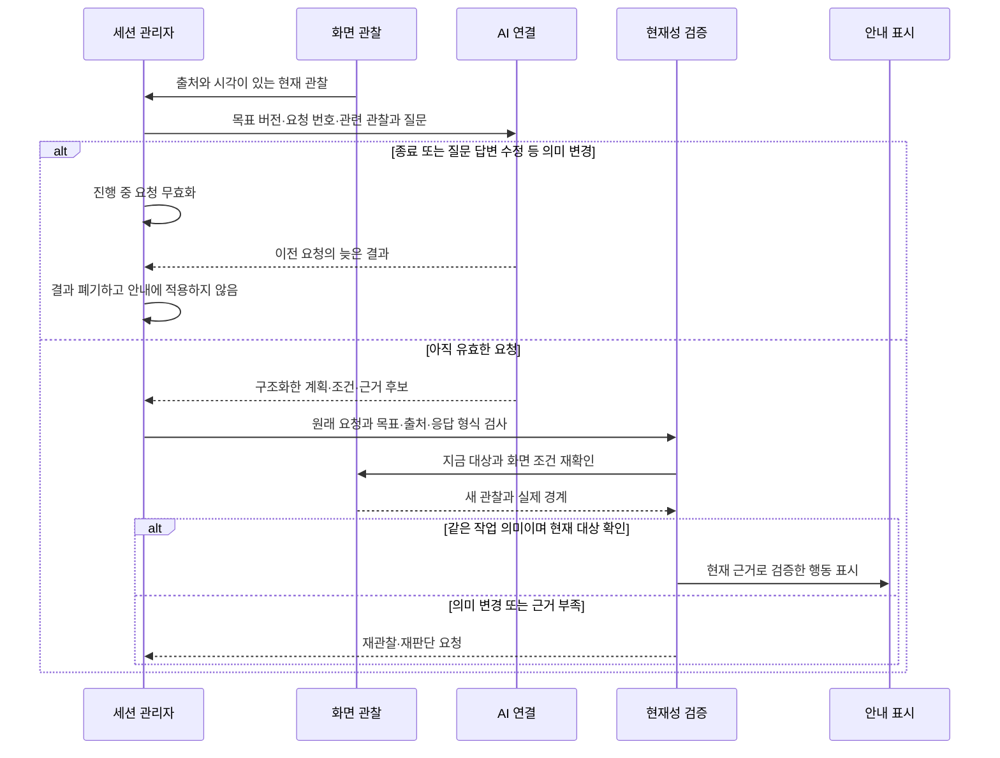

인터넷 없음, 공용망 로그인, DNS·TLS·인증·한도·모델 계약·잘못된 JSON·부분 배치 실패를 원인별로 구분한다. 입력과 유효한 답은 보존한다. 같은 요청의 중복 처리와 결과 적용을 막는다. AI 조회 재시도와 대상 앱의 전송·결제 재실행은 전혀 다른 작업이다.

화면이 한 픽셀이라도 변하면 항상 전체 판단을 버리는 방식도 피한다. 단순 위치 변화는 최신 대상 재검증으로 처리할 수 있지만, 목표 의미·계정·매장·입력 대상이 바뀌면 이전 의미 판단을 재사용하지 않는다. 같은 화면 번호만으로 목표 적합성을 승인하지 않는다.

17회차에는 이미 검증해 실제로 강조했던 확정 대상의 분류를 재분석 중 별도로 유지한다. 표시를 지운 뒤 사용자가 그 버튼을 실제로 누르면, 동일한 목표 버전·창·출처와 현재 대상·범위·준비 항목을 대조한 후 기존 실행 원장에 클릭을 기록한다. 표시 중의 직접 클릭과 같은 결과 검증을 거치며 클릭 자체는 성공이 아니다. 원래 클릭 전 관찰의 시각을 새 시각으로 바꾸지 않는다. 새 계획·입력 변경·문맥 변화·부분 관찰·중단·종료는 이 임시 분류를 만료시키고, 해당 클릭은 이전 판단 요청을 무효화한다. 오래된 응답이 돌아와도 같은 확정을 다시 안내하지 못한다. 이 연결은 모든 버튼을 확정으로 추측하는 규칙이 아니다. 아직 분류하지 않은 다른 버튼·처음부터 안내 밖에서 일어난 확정·이미 결과가 불명인 상태의 추가 실행·새 초안 세대는 별도 대조가 필요하다.

31회차에는 이름이 같은 이동 버튼의 공개 설명이 입력 계획 응답 전에 바뀌는 경로를 검증했다. 응답이 도착하면 처음 관찰에서 입력 준비가 성립했는지, 최신 관찰에서도 같은 카드의 비활성 버튼인지 확인한다. 이전 설명을 근거로 만든 계획은 폐기한다. 현재 버튼의 공개 설명이 바뀌었거나 사라졌다면 같은 목표 버전으로 최신 관찰에 새 요청을 한 번 만든다. 다른 카드의 문구 변화만으로는 이 요청을 만들지 않는다. 다시 응답을 기다리는 동안 같은 근거가 또 달라지면 자동 요청을 멈추고 재확인 안내를 띄운다. 미결 확정은 기존 결과 검증을 우선한다. 최초 응답이 준비 대상을 밝히기 전에 선제 취소하는 경로는 이번 검증에 포함하지 않았다.

33회차에는 첫 관찰에서 화면 밖에 걸쳤던 공개 제목이 응답 전 같은 카드 안에서 온전히 보이는 경우를 다뤘다. 제목·버튼·공통 묶음이 같은 창과 출처에서 유지됐음을 확인하고 최신 관찰로 새 계획을 한 번 요청한다. 화면 밖에 걸친 제목은 재관찰의 이유에만 쓰고 행동을 승인하는 근거로 쓰지 않는다. 원래 제목과 버튼이 같은 묶음에 있었음을 확인할 수 없거나 제목이 다른 묶음에서 나타나면 이 경로를 사용하지 않는다.

## 12. D11 실패와 미관찰을 구분한 복구

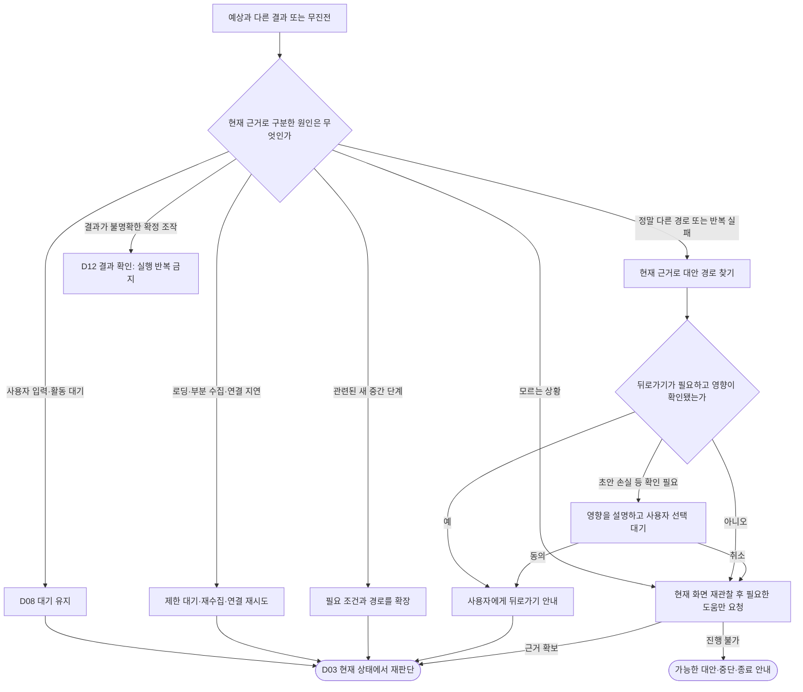

같은 화면이라는 이유만으로 무진전이라고 하지 않는다. 선택·값·활동 상태도 진전이 될 수 있다. 반대로 화면 이동만으로 성공이라고 하지 않는다. 내부 탐색·모델 재시도 예산 소진은 기능 부재나 전체 과업 실패의 증거가 아니다. 무한 자동 재시도 대신 사용자가 이해할 수 있는 대안과 종료를 제공한다.

2026-11-07 구현에서 D10·D11의 계획 수정을 구체화했다. 검증기가 거부한 계획은 원장 반영 전에 진단 코드로 되돌려 같은 목표·관찰·연결에서 한 번 수정할 수 있다. 잘못된 제안 원문·예외 메시지를 모델 명령으로 보내지 않는다. 수정 중 관찰이나 요청 수명이 바뀌면 늦은 결과를 적용하지 않는다. 인증·한도·연결 오류·불명 실행 결과는 이 자동 계획 수정의 허가가 아니다. 수정 예산은 관찰 요청별이며 전체 안내 단계 수와 독립적이다. 400ms 간격, 세부 거부 코드의 가용 범위, 변화 중인 화면의 보수적 재확인 처리와 실제 검증은 `android/app3/IMPLEMENTATION.md` 8회차에 기록한다.

11회차에는 공개 장면의 HTTP 502 뒤 같은 요청 문맥에 진단 코드만 더한 재평가를 한 번 수행했다. 목표·관찰·이전 계획·조건·지시문·모델이 그대로임을 비교하고 응답 수락을 확인했다. 이 시험은 호스트가 요청한 읽기 전용 재평가이며, 실제 Android 클라이언트의 요청 티켓과 승인 객체를 유지한 실시간 자동 복구 검증과 구분한다. 실패 원문의 세부 원인은 확보하지 못했으므로 특정 필드 오류나 속도 개선으로 결론내리지 않는다.

27회차에는 사용자가 제목을 명시했고 현재 관찰에서 해당 제목과 이동 버튼의 연결이 하나로 확인되는 경우를 보정에 연결했다. AI가 다른 버튼을 고르거나 맞는 제목의 참조를 빠뜨렸다면, 같은 요청에서 진단 코드로 한 번만 보정한다. 두 번째 제안도 같은 제목·버튼·묶음을 현재 화면에서 확인해야 표시할 수 있다. 제목과 버튼의 연결을 확인할 수 없으면 이 진단을 보내지 않고 현재 화면을 다시 확인하도록 안내한다.

32회차에는 이미 범위를 확인한 이동 버튼의 보정에 한해 공개 설명을 관찰하는 범위를 좁혔다. 요청한 버튼의 설명이 바뀌면 같은 목표로 최신 화면을 다시 판단하고 이전 보정 응답을 폐기한다. 이 자동 재판단은 한 번으로 제한한다. 다른 묶음의 같은 이름 버튼에서 설명만 바뀌면 기존 보정을 유지한다. 보정 응답이 그 버튼을 직접 참조하면 최신 근거와 다시 대조한다. 그룹 구조·다른 속성·일반 계획의 보정에는 기존 검증을 적용한다.

39회차에는 읽기 전용 이동 뒤 출발 목록의 다른 카드 이름과 일치하는 새 영역을 확인하면 목적지가 다르다고 안내한다. 출발 영역을 명시하는 유일한 돌아가기 버튼이 현재 영역 안에 있고 입력·조절·확정과 관련된 화면 근거가 보이지 않을 때 버튼을 표시한다. 사용자가 누른 뒤 최신 화면으로 원래 목표를 이어간다. 확인할 이름이 없거나 돌아가기의 대상이 모호하면 재확인을 유지한다.

40회차에는 출발 화면의 공개 입력 상태도 확인한다. 보이는 입력란에 내용이 있거나 비어 있는지 확인할 수 없으면 돌아가기 버튼을 강조하지 않는다. 다른 항목임이 확인된 화면에 입력란이 뒤늦게 나타나면 기존 강조를 거두고 작성 중인 내용을 확인해 달라고 안내한다. 초안 원문은 이 판단에 쓰지 않으며, 앱이 공개하지 않은 초안의 존재나 복원은 별도 검증이 필요하다.

41회차에는 안내한 돌아가기 버튼의 클릭과 이전 화면 복원을 분리한다. 클릭 뒤 새 관찰에서 출발 영역과 목표 제목에 연결된 버튼이 함께 확인될 때 원래 목표를 이어간다. 돌아가기 클릭 뒤 실제 목표가 나타나면 기존 완료 검증을 적용한다. 화면이 그대로이거나 근거가 부족하면 제한 시간 뒤 재확인 버튼을 표시한다. 재확인은 화면만 다시 읽으며, 돌아가기 지시나 AI 계획 요청을 반복하지 않는다.

42회차에는 같은 목표에서 출발 목록으로 복원한 뒤 같은 버튼이 같은 다른 항목을 다시 열면 해당 경로를 기록한다. 안전한 돌아가기 조건은 그대로 적용한다. 출발 화면에서 실패한 버튼이 다시 제안되면 현재 근거에서 다른 행동을 찾도록 한 번 보정한다. 다른 근거를 찾지 못하면 반복 안내를 멈춘다. 앱별 경로는 사용하지 않는다.

43회차에는 출발 영역·목표 항목·버튼·도착 영역을 묶어 실패를 따로 보관한다. 다른 버튼을 시도해도 앞선 경로의 실패나 차단이 사라지지 않는다. 대체 안내를 받는 중 현재 버튼이 바뀌면 이전 응답은 버리고 새 관찰로 판단한다.

44회차에는 오진입 뒤 원래 출발 영역과 목표 버튼이 새 관찰에서 다시 확인되면 복원으로 기록한다. 앱의 돌아가기 버튼 클릭 기록이 없는 경우에도 적용한다. 대체 계획 요청에는 그 요청에 실린 공개 노드 중 차단된 버튼 ID만 담는다. 실제 화면에서 보인 차단 버튼만 보정에 쓰며, 늦은 응답과 다른 관찰에는 재사용하지 않는다.

45회차에는 복구 중에도 현재 실행할 수 있는 첫 행동을 지정한다. 검색·필터 등의 안전한 경로가 보이면 그 버튼을, 다음 행동 전에 입력이 필요하면 해당 입력란을 안내한다. 대안이 없는 응답은 원래 목록에서 진행이 어렵다고 안내하고, 도착 확인을 다시 요구하지 않는다. 공개 합성 화면 세 건에서 승인된 구독 모델의 응답을 검증했다.

46회차에는 복구 후 검색 결과에 이동 버튼이 하나만 보여도 요청한 제목과 같은 묶음에 속하는지 확인한다. 다른 결과의 버튼은 강조하지 않는다. 버튼이 그대로여도 제목 변화로 관계가 확인되면 새 안내를 구성한다. 결과 목록에 이름이 보인 시점과 실제로 연 화면에서 그 이름을 확인한 시점을 구분한다.

47회차에는 복구 후 검색 목록에서 제목 자체가 클릭되는 행도 확인한다. 요청과 같은 공개 제목이 여러 항목에 있으면 선택을 보류한다. 제목이 하나로 구분되면 그 행을 강조하고, 클릭 후 새 화면의 제목을 확인할 때 완료한다.

48회차에는 같은 제목의 행을 공개 날짜나 부제로 구분한다. 사용자가 제목과 별도로 명시한 표현이 현재 한 행 안에서만 확인될 때 그 행을 안내한다. 클릭 뒤 새 화면의 이름과 같은 구분 정보가 함께 확인될 때 완료한다. 표시되지 않은 정보와 일부만 겹치는 표현은 구분 근거로 쓰지 않는다.

28회차에서는 제목으로 확인한 버튼의 비활성 상태를 별도로 처리한다. 다른 카드에서 같은 이름의 버튼을 누를 수 있어도 요청한 카드의 상태를 알리고 기다린다. 같은 비활성 상태가 이어지는 동안 모델을 다시 호출하지 않는다. 현재 관찰에서 활성 여부나 범위가 바뀌면 원래 목표로 다시 판단한다.

29회차에서는 앱이 비활성 버튼의 공개 상태로 입력을 안내하고, 계획이 그 입력을 앞선 준비로 제안한 경우를 구분한다. 기기는 입력란과 버튼이 같은 카드에 있으며 입력란이 비어 있는지 확인한다. 연결을 확인할 수 없으면 관찰된 상태를 안내하고 기다린다. 입력값의 정확성이나 완료를 비활성 이유만으로 판단하지 않는다.

## 13. D12 확정 행동과 전체 완료

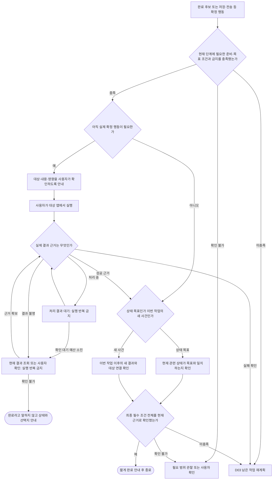

이 그림의 첫 검사는 확정 전 필요한 준비 조건이다. 저장 전에는 아직 저장 결과를 필수 준비 조건으로 요구하지 않는다. 저장·전송 후에는 최종 결과 조건을 별도로 평가한다. 기존 전송 내역이나 이미 있던 알람을 이번 실행의 새 결과로 착각하지 않는다. 처리 중에도 확인 대기 예산과 중단 경로를 두고, 무기한 폴링하지 않는다.

화면이 공개하는 근거가 부족하면 확인 불가다. 사용자의 보고는 사용자 확인으로 기록하고 시스템이 독립 검증했다고 바꾸지 않는다. 완료 판정 뒤에는 만족도 질문 없이 안내를 정리한다.

36회차에는 이름으로 지정한 카드의 읽기 전용 이동도 결과를 따로 확인하도록 연결했다. 기기가 표시한 버튼과 일치하는 클릭을 받은 뒤, 더 최신 관찰에서 원래 카드 버튼이 사라지고 요청한 이름의 새 공개 제목이 나타났는지 확인한다. 모델의 필수 결과 조건도 해당 제목을 근거로 인용해야 한다. 로딩 문구, 다른 결과 제목, 원래 목록 제목이면 완료 대신 ‘다시 확인’을 제공한다. 확인에 쓰인 공개 제목이 바뀌면 재판단하며, 기기에서 제목 역할을 읽을 수 없으면 이 경로는 완료를 보류한다. 제목 역할은 Android가 접근성 노드에 공개하는 값을 사용한다. [Android 접근성 제목 문서](https://developer.android.com/reference/android/view/accessibility/AccessibilityNodeInfo#isHeading())

37회차에는 새 화면 영역의 접근성 이름을 도착 근거에 추가했다. 요청과 일치하는 새 영역이 하나면 제목 역할이 없어도 그 영역 노드를 필수 결과 근거로 사용할 수 있다. 같은 이름의 영역이 여러 개 보이거나 제목이 다른 이름의 영역 안에 있으면 해당 증거를 보류한다. 모델 요청에는 사용자 요청에 이미 포함된 공개 영역 이름만 추가한다. 이동 버튼의 위치만 달라졌을 때는 클릭 전에 끝난 최신 관찰에서 같은 카드를 재확인하고 그 좌표로 클릭을 대조한다. [Android 영역 이름 문서](https://developer.android.com/reference/android/view/accessibility/AccessibilityNodeInfo#getPaneTitle())

38회차에는 읽기 전용 이동의 결과 근거가 부족할 때 ‘다시 확인’을 누르면 단말이 새 화면을 한 번 읽도록 연결했다. 2초 안에 새 관찰을 얻으면 결과 제목이나 영역 이름을 대조한다. 근거가 생기면 자동 검증을 이어가고, 없으면 화면을 직접 확인하도록 안내한다. 지정된 클릭과 새 화면을 확인했고 필수 결과가 하나인 경우에 사용자 확인 버튼을 제공한다. 사용자가 확인하면 안내를 종료하고 기록에 ‘사용자 확인’으로 표시한다. 화면이 바뀌거나 새 관찰을 얻지 못하면 이전 확인을 받지 않는다.

## 14. D13 두 상황에서 질문 위치가 다른 이유

이 그림은 고정 실행 코드가 아니라 인수 시험용 예시다. 실제 순서와 제스처는 현재 화면에 따라 구성한다.

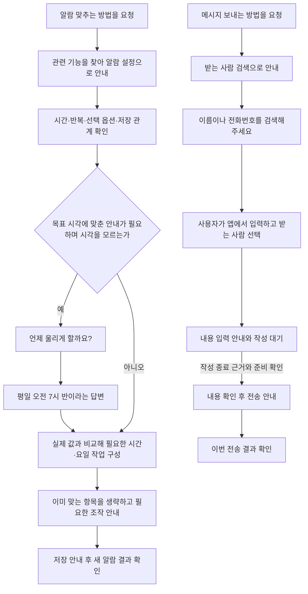

수신자를 찬찬히에게 먼저 말한 뒤 앱에 다시 쓰게 하지 않는다. 반대로 이름을 알아야만 가능한 별도 경로 판단이 생기면 D06 기준으로 다시 판단한다. 알람 시간도 무조건 질문하는 필드는 아니며, 사용자가 조절 방법만 원하는 경우 값 없이 안내할 수 있다.

## 15. 전체 처리 순서와 반환 종류

| 순서 | 처리 | 결과 |
| --- | --- | --- |
| 1 | 종료·잠금·권한·출처 변경 등 우선 사건 처리 | 중단·정리 또는 계속 |
| 2 | 입력·질문 답변을 현재 세션에 연결 | 목표와 조건의 새 버전 |
| 3 | 기능·제공자·관련 지식을 확인 | 관련 후보와 모르는 부분 |
| 4 | 현재 화면과 관찰 범위를 수집 | 역할·관계·값·가림·시각 |
| 5 | 목표 관련 전체 작업을 구성 | 필수·대안·순서·복수·조건·유지 |
| 6 | 현재 근거와 원하는 조건의 차이를 계산 | 충족·미충족·확인 불가 |
| 7 | 질문이 필요한지 D06으로 판단 | 질문 또는 앱에서 조작 안내 |
| 8 | 관찰·질문·안내·대기·복구·완료 후보 중 선택 | 이유와 근거가 있는 제안 |
| 9 | 원래 요청의 수명과 실제 대상을 검증 | 표시 허용 또는 재관찰 |
| 10 | 사용자 조작·답변·결과를 기다리고 관찰 | 실제 변화와 아직 모르는 것 |
| 11 | 이번 변화가 목표에 미치는 영향 평가 | 계획 갱신 또는 완료 검증 |
| 12 | 최종 조건 확인과 정리 | 완료·확인 불가·사용자 종료를 구분 |

AI 제안에는 필요한 작업 전체, 선택 이유의 짧은 요약, 관찰 근거, 부족한 정보, 다음 판단 종류, 행동 시 필요한 대상 참조와 확인 조건을 담는다. 장황한 내부 추론을 사용자에게 표시하거나 저장하는 요구는 아니다. 구조가 맞는 응답도 의미가 틀릴 수 있으므로 실제 평가가 필요하다.

## 16. 누락 점검과 인수 기준

기존 버전 2 문서의 예외 68개, 행동·제스처 39개를 `coverage.csv`에서 처리 그림과 정책에 연결한다. 이는 설계 대응표이며 시험 통과 수가 아니다. 이전 문서의 화면 번호·시간 값·고정 문구를 버전 3의 확정 UI로 가져오지 않는다. 새 핵심 사례는 `acceptance.csv`에 별도로 둔다.

인수 기준에는 앱 이름 없는 요청, 세 개 이상의 관련 조절칸, 24시간제, 이미 충족된 값, 복수 선택, 첫 글자 입력, 동명이인, 진행 활동, 정상 중간 화면, 숨은 탐색 중 개입, 이미지 좌표, 늦은 응답, 결과 불명인 확정 행동, 오버레이 유지, 만족도 질문 없는 종료를 포함한다.

실제 모델·앱·새 사용자 표현을 써서 필수 항목 누락, 잘못된 질문, 성급한 다음 안내, 잘못된 완료, 제약 위반, 단계별 지연을 측정한다. 새 앱·다른 앱 버전·다른 언어 및 글자 크기·키보드·권한·팝업도 구분한다. 개발 중 본 사례와 최종 평가 자료는 분리한다. 모든 가능한 앱 상황을 열거했다고 주장하지 않으며, 미지의 상황은 D07·D11의 확인 불가·재관찰·대안·종료 경로로 연결한다.

## 17. 참고한 자료와 적용 범위

| 자료 | 적용할 아이디어 | 그대로 주장하지 않는 것 |
| --- | --- | --- |
| [Agent-SAMA](https://arxiv.org/html/2505.23596v3) | 계획·상태·전이·결과 검증·복구 연결 | 자동 실행 벤치마크 성능을 찬찬히의 안내 성능으로 옮기지 않음 |
| [KG-RAG](https://aclanthology.org/2025.emnlp-main.274/) | 목표에 관련된 앱 기능·경로 검색 | 사전 경로가 현재 버튼·값을 증명한다는 해석 |
| [KnowNo](https://robot-help.github.io/) | 불확실할 때 필요한 도움을 요청하는 판단 | 별도 보정 없이 통계적 성공 보장을 주장하지 않음 |
| [AndroidWorld](https://google-research.github.io/android_world/) | 다양한 과업 조건과 결과 근거를 이용한 평가 | 시험 환경의 내부 상태 접근을 일반 앱 권한으로 전제하지 않음 |
| [기존 조건부 계획](../CONDITIONAL_PLANNING.md) | 예상 화면 하나 대신 목표 관련 조건으로 재계획 | 제한 모형의 성공을 일반 앱 성공으로 합산하지 않음 |
| [기존 안내 시점](../GUIDANCE_TIMING.md) | 입력·대기·음성 종료와 작성 완료 분리 | 고정 지연 시간이나 첫 글자로 완료 추정하지 않음 |
| [기존 실제 스톱워치 시험](../PASSIVE_CONTROL_TRANSITION_STUDY.md) | 클릭 기록 없는 변화와 활동 유지의 필요성 | 시작 뒤 중지를 고른 흐름을 전체 성공으로 세지 않음 |
| [기존 관찰 가림 시험](../WINDOW_COVERAGE_STUDY.md) | 접근성 속성과 실제 시각·터치 가림 구분 | 보인다는 플래그 하나로 조작 가능성을 확정하지 않음 |
| [기존 완료 근거 설계](../PROGRESS_EVIDENCE.md) | 현재 상태·새 사건·상대 변화·금지 조건 구분 | 모델의 완료 발화만으로 성공 판정하지 않음 |

## 18. 구현 전에 검증해 정할 값

| 항목 | 이 문서의 결정 | 다음 검증 |
| --- | --- | --- |
| 질문 묶음과 문구 | 지금 필요한 구분만 묻고 앱 내 입력을 중복 수집하지 않음 | 초보 사용자의 이해와 답변 부담 |
| 입력 종료 수단 | 자동 추정만 믿지 않으며 모든 단계에 확인 버튼을 강제하지 않음 | 조건부 문구·선택적 다음 안내·앱 자체 전환의 조합 |
| 제한 탐색 | 안전성과 기기 지원이 확인된 범위에서만 허용 | 고정 화면의 터치·이벤트·복구 실기기 시험 |
| 기다림과 재시도 | 원인별 자원 예산을 두고 전체 안내 횟수와 분리 | 실제 지연 분포·서비스 오류·이용자 수행 시간 |
| 완료 근거 | 현재 상태와 이번 새 사건을 구분하고 미상을 보존 | 앱별 공개 결과의 충분성과 오판율 |

이 값이 정해지지 않았다고 임의의 앱별 예외나 근거 없는 확률 문턱값으로 대체하지 않는다. 본 문서의 설계 대응 완전성과 실제 서비스의 일반화 성능은 구분한다.
